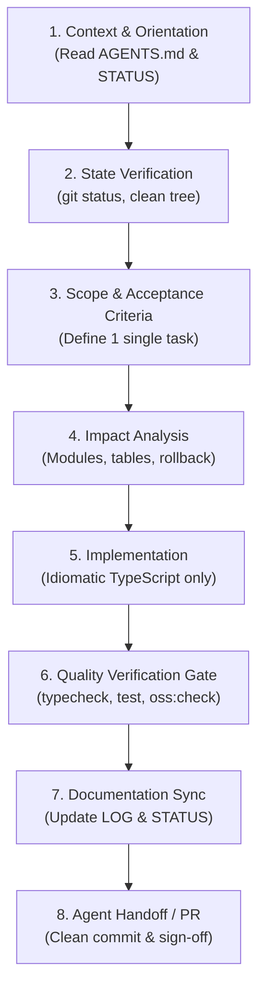

# AGENTS.md — Dwarapalak Engineering Governance & Operational Protocol

**Target Repository:** `D:\Dwarapalak-repo`  
**Project:** Dwarapalak (India-First Commercial SaaS CRM based on GoHyperLevel)  
**Authority:** JITEN EDU TECHNOLOGIES  
**Effective Date:** 2026-11-18  

---

## 1. Core Operating Philosophy

Every human developer and AI coding agent operating in this repository is bound by this document. This protocol ensures the preservation of existing intellectual property, mathematical correctness (GST/INR), multi-tenant security, and zero regressions.

---

## 2. Mandatory Pre-Task Orientation (Read First)

Before inspecting code, running commands, or making edits, every agent MUST:

1. **Read Canonical Governance Documents:**
   - [AGENTS.md](file:///D:/Dwarapalak-repo/AGENTS.md) (this document) — Master rules and constraints.
   - [PROJECT_STATUS.md](file:///D:/Dwarapalak-repo/PROJECT_STATUS.md) (or [docs/PROJECT_STATUS.md](file:///D:/Dwarapalak-repo/docs/PROJECT_STATUS.md)) — Current active phase, verified baseline, and agent handoff state.
   - [docs/DEVELOPMENT_LOG.md](file:///D:/Dwarapalak-repo/docs/DEVELOPMENT_LOG.md) — Historical progress and recent architectural decisions.
2. **Inspect Git & Runtime State:**
   - Execute `git status` and `git branch` to confirm the active working tree is clean.
   - Verify active branch (`feat/stage-5-business` or designated feature branch).
   - If uncommitted files or unexpected modifications exist, **STOP** and report immediately. Never build on an unverified dirty tree.
3. **Single Agent Ownership:**
   - Exactly one agent owns a working tree and its running background processes at any given time.
   - Background tasks must be tracked, checked, and cleanly stopped or accounted for before handing off.

---

## 3. Strict Git, Database & Code Safety Rules

1. **Non-Destructive Git Mandate:**
   - **PROHIBITED:** `git reset --hard`, `git push --force`, `git clean -fd`, `git checkout .`, `git rebase` without explicit instruction.
   - Never delete existing branches or tags (`dwarapalak-stage5-checkpoint`).
   - All 16 custom commits (`04824de` through `3b0a629`) must be strictly preserved.
2. **Database & Data Isolation:**
   - Never overwrite, delete, reseed, or alter databases in `data/` or `data-demo/`.
   - Never commit `.db`, `.db-wal`, `.db-shm`, `.sqlite`, or `data/` directories to Git.
   - `scripts/oss-check.mjs` enforces this; never bypass its checks.
3. **Preservation of Indian Commercial Stack:**
   - Never revert, overwrite, or break:
     - 15-character GSTIN validation (`isValidGstin`) and state code extraction (`extractStateCode`).
     - CGST / SGST / IGST calculation engine (`calcGstTotals`) and Tax Invoice generation.
     - Modular payment providers: Razorpay (`server/services/pay-razorpay.ts`) and Cashfree (`server/services/pay-cashfree.ts`).
     - 100% English UI translation layer across 68 routes with `web/src/ui.tsx` primitive auto-translation and `web/src/i18n/vocabulary.ts`.
     - `en-IN` Lakh/Crore numbering and `Asia/Kolkata` (+5:30) timezone rules.
4. **Zero Embedded Secrets:**
   - Never hardcode API keys, passwords, webhook secrets, or private tokens in source code.
   - All secrets must load via environment variables (`process.env`) or sealed settings (`openSettings` / `sealSettings`).

---

## 4. Scoped Task Execution Lifecycle

Every task must progress through these disciplined phases:

1. **Task Definition:** Define exactly **one scoped objective** with measurable acceptance criteria.
2. **Impact Analysis:** Identify affected files, modules, database tables, and any potential downstream regression risks.
3. **Implementation:** Make minimal, targeted changes. Do not introduce extraneous dependencies or refactor unrelated code.
4. **Sandbox Compliance:** Run commands inside standard sandbox mode first. Bypass sandbox only for host port binding or authorized network operations.

---

## 5. Mandatory Verification Quality Gate

Before declaring any implementation task complete, the agent must run and pass the following quality gate:

| Step | Command | Acceptance Standard |
| :--- | :--- | :--- |
| **1. TypeScript Compilation** | `npm run typecheck` | **0 errors** across server, web, and scripts. |
| **2. Test Execution** | `npx vitest run tests/<relevant>.test.ts` | **100% passing** with zero unhandled rejections. |
| **3. Full Test Suite (Milestone)** | `npm test` | All regression and feature suites pass. |
| **4. Localization Completeness** | `npm run i18n:check` | **0 missing, 0 untranslated, 0 unused keys**. |
| **5. Secret & Security Audit** | `npm run oss:check` | **0 leaked secrets, forbidden files, or private IPs**. |
| **6. Production Asset Build** | `npm run build` | Clean `dist-web` and `dist-server` generation. |

---

## 6. Documentation & Agent Handoff Protocol

Upon successful verification:

1. **Update `docs/DEVELOPMENT_LOG.md`:** Append a chronological log entry detailing:
   - Task ID & Objective
   - Agent / Model identity
   - Files changed
   - Git branch and commit hash
   - Tests executed and exact results
   - Architectural decisions & next recommended task
2. **Update `PROJECT_STATUS.md`:** Update active phase, task status, test matrix, and current blockers.
3. **Active Agent Handoff:**
   - Record exact Git HEAD, branch, and working-tree status.
   - Record any background processes or local servers still running.
   - State the unambiguous next resumption task for the incoming agent.
