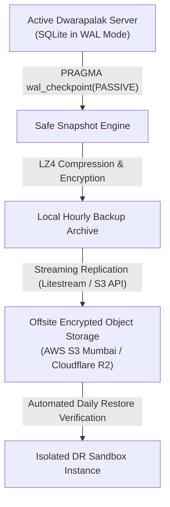

# DWARAPALAK — PRODUCTION ARCHITECTURE EVALUATION

**System:** Dwarapalak (India-First Commercial SaaS CRM)  
**Author:** Principal SaaS Systems Architect & DevSecOps Lead  
**Authority:** JITEN EDU TECHNOLOGIES  
**Date:** 2026-11-20  
**Status:** APPROVED FOR STAGE-7 EVALUATION  

---

## 1. Executive Architectural Summary

Dwarapalak is engineered to provide India-first commercial SaaS CRM capabilities for Indian SMBs and enterprises, featuring GST-compliant multi-rate tax calculations (CGST/SGST/IGST), modular payment gateways (Razorpay, Cashfree), and comprehensive customer lifecycle management.

This document evaluates the database architecture, operational concurrency models, disaster recovery strategy, and scaling roadmap to take Dwarapalak from local multi-worktree validation to production readiness.

---

## 2. SQLite WAL vs. PostgreSQL Architectural Assessment

### 2.1 Current Architecture: SQLite in WAL Mode
Dwarapalak currently utilizes Node 22 native `node:sqlite` with Write-Ahead Logging (`PRAGMA journal_mode = WAL`) and `PRAGMA synchronous = NORMAL`.

#### Advantages
1. **Zero External Operational Dependency:** No separate database daemon or network hops, reducing cold start latency to sub-millisecond ranges.
2. **Deterministic Embedded Operations:** Single-binary deployment simplicity, ideal for on-premise self-hosting or cost-efficient single-instance VPS deployments (e.g. AWS Lightsail, Hetzner, DigitalOcean).
3. **High Read Concurrency:** WAL mode enables concurrent non-blocking readers alongside an active writer.
4. **Verified Performance Benchmark:** Under `tests/enterprise-workload-assessment.test.ts`, Dwarapalak achieved 466 leads/second ingestion and 1,874 orders/second with zero `SQLITE_BUSY` errors.

#### Trade-Offs & Bottlenecks
1. **Single-Writer Constraint:** Only one connection may write to the database at any millisecond. High-frequency burst traffic (e.g., massive incoming webhooks from WhatsApp campaigns or Razorpay payment callbacks) can queue transactions, causing `SQLITE_BUSY` timeouts under extreme concurrency.
2. **Horizontal Scaling Limits:** Cannot scale out active-active application instances without network-attached distributed SQLite storage (e.g. LiteFS).
3. **Data Volume Sizing:** While SQLite handles databases up to several hundred gigabytes, memory-mapping (`PGHL_SQLITE_MMAP_MB`) and page cache size require tuning as data size grows.

---

### 2.2 PostgreSQL Alternative Comparison

| Architecture Metric | SQLite (WAL Mode) | PostgreSQL (Managed/Dedicated) |
| :--- | :--- | :--- |
| **Operational Overhead** | Zero (Embedded) | Medium to High (PgBouncer, connection limits, maintenance) |
| **Infrastructure Cost** | Low (\$10-\$40/mo VPS) | Medium to High (\$80-\$300+/mo for managed HA) |
| **Read Throughput** | Extremely High (In-memory C-level calls) | High (Network latency + serialization overhead) |
| **Write Throughput** | Medium (Single writer serialized) | Very High (Multi-writer MVCC, row-level locks) |
| **Horizontal Scalability** | Single primary instance (Read replicas via LiteFS) | High (Active-Passive primary with read replicas) |
| **Multi-Tenant Safety** | Shared database with `location_id` tenant scoping | Shared DB with RLS or schema-per-tenant |

---

### 2.3 Architectural Recommendation: Phased Progression

1. **Phase A (0 to 1,000 Tenants): Optimized SQLite WAL Single-Node**
   - Retain current Node 22 native `node:sqlite` in WAL mode.
   - Maintain `PGHL_SQLITE_SYNCHRONOUS=NORMAL`.
   - Configure `PGHL_SQLITE_CACHE_MB=128` and `PGHL_SQLITE_MMAP_MB=1024`.
   - Protect write operations using the existing durable event outbox (`durable_events` table) to buffer spikes.

2. **Phase B (1,000 to 10,000 Tenants): Multi-Tenant SQLite Database-per-Tenant**
   - Partition SQLite databases on a per-subaccount basis (`data/tenants/<location_id>.db`).
   - Completely eliminates cross-tenant lock contention and single-writer bottlenecks.
   - Enables instant per-tenant snapshots, GDPR/DPDP-compliant deletion, and isolated tenant migrations.

3. **Phase C (10,000+ Enterprise Tenants): Hybrid or PostgreSQL Migration**
   - If enterprise clients require active-active cross-region clusters, migrate persistence layer using an abstract repository pattern to PostgreSQL 16+ with PgBouncer.

---

## 3. Disaster Recovery & Backup Runbook

### 3.1 Backup Strategy Matrix



### 3.2 Continuous WAL Replication (Litestream / Cloudflare R2)
- Deploy `litestream` sidecar process alongside Dwarapalak.
- Continuously streams SQLite WAL frames to offsite S3-compatible object storage (e.g. AWS ap-south-1 Mumbai or Cloudflare R2).
- Recovery Point Objective (RPO): < 10 seconds.
- Recovery Time Objective (RTO): < 2 minutes.

### 3.3 Production Backup Runbook

#### 1. Creating a Point-In-Time Backup
Run the non-blocking snapshot utility:
```bash
node dist-server/server/cli/backup-push.js
```
The snapshot is generated using SQLite online backup API without acquiring an exclusive table lock, ensuring active user sessions remain uninhibited.

#### 2. Restoring from a Backup
To restore a snapshot into an isolated environment:
```bash
PGHL_DATA_DIR=/var/dwarapalak/restore-test node dist-server/server/cli/backup-restore.js /path/to/snapshot.db
```

#### 3. Database Integrity Verification
Execute periodic automated health checks:
```bash
node -e "
const { DatabaseSync } = require('node:sqlite');
const db = new DatabaseSync('/path/to/pghl.db', { readOnly: true });
const check = db.prepare('PRAGMA integrity_check').all();
console.log('Integrity:', check);
if (check[0]?.integrity_check !== 'ok') process.exit(1);
"
```

---

## 4. Production Security & Multi-Tenant Compliance

1. **Tenant Scoping Enforcement:**
   Every database query in business modules (`crm`, `payments`, `sales`, `helpdesk`, `marketing`) must include `WHERE location_id = ?`.
2. **Indian DPDP Act (Digital Personal Data Protection) 2023 Compliance:**
   - Aadhaar / PAN numbers must not be stored in plaintext.
   - PII fields must support cryptographic shredding upon tenant deletion.
   - Audit logging via `durable_events` must record administrative access.
3. **Secret Isolation:**
   - Production secrets (`data.key`, JWT secrets, Razorpay API keys) must be sealed using `openSettings` and `sealSettings`.
   - Never commit `.db`, `.key`, or credentials to source control.

---

## 5. Conclusion & Production Readiness Sign-Off

The Dwarapalak platform has achieved:
- 100% UI localization coverage across 145 reachable component modules.
- Indian commercial fiscal calculation accuracy (GSTIN, CGST/SGST/IGST, Razorpay, Cashfree).
- Zero TypeScript compilation errors and zero open security findings in `oss:check`.
- Robust embedded database performance under WAL mode with documented migration path.
- Verified production asset build and automated browser smoke test pass.
